# Structure des fichiers

```text
├── github/workflows
├── README.md
├── index.html          # Page d'accueil
└──site/
    ├── histoire.html       # Page Histoire & Entreprise
    ├── services.html       # Page Services & Solutions
    ├── economie.html       # Page Économie
    ├── ecologie.html       # Page Écologie
    ├── css/
    │   └── style.css       # Styles
    └── img/                # Dossier pour les médias
        ├── contributeur.png
        ├── Mistral_AI_logo.png
        ├── W3C_Accueil.png
        ├── W3C_Histoire.png
        ├── W3C_Services.png
        ├── W3C_Economie.png
        ├── W3C_Ecologie.png
        ├── arr_evolution.png
        ├── datacenter_energie_renouv.png
        ├── favicon.ico
        ├── images_total.jpeg
        ├── levées_valorisation.png
        ├── mistral-ai.jpg
        ├── mistral-ca.jfif
        ├── mistral-cb.jpg
        ├── mistral-chat.jpg
        ├── mistral_vitre.jpg
        ├── robot_mistral.webp
        ├── studio.jpg
        ├── temp.jpg
        └── veolia.png
```


# SAÉ S1. 05-06

## Mistral.ai

[SAE_Mistral.ai_Accueil](https://MartinClovis.github.io/SAE_Mistral.ai)

## Membres du groupe :

Etudiant 1 (référent du groupe) :  [RBAIHI Inas](mailto:inas.rbaihi@edu.univ-fcomte.fr?subject=SAE_1_05_06)  
Etudiant 2 : [MARTIN Clovis](mailto:clovis.martin@edu.univ-fcomte.fr?subject=SAE_1_05_06)   
Etudiant 3 : [POICHET Charles](mailto:charles.poichet@edu.univ-fcomte.fr?subject=SAE_1_05_06)  
Etudiant 4 : [OZDEMIR Dogan](mailto:dogan.ozdemir@edu.univ-fcomte.fr?subject=SAE_1_05_06)  
(pour copier l'addresse email d'un étudiant, faites un clique droit sur un prénom)
# Présentation du projet

Dans se projet nous devrons présenter une entreprise, mistral.ai pour notre part, pour se faire, on devra créer un site web pour la présenter tout en se répartissant les taches a travers les 4 membres du groupes, taches qui seront recueilli dans le dossier SAE dans moodle. Il y aura 5 pages, ces 5 pages seront conformes aux demandes du/des client, il y aura donc ; une page d'accueil, une page sur l'histoire de la compagnie, une sur les services fournis par l'entreprise, une autre sur l'économie et une dernière sur l'écologie (d'autres taches seront demander sur le SAE de moodle). Chaque élèves devra avoir fait au moins une page et celle-ci devra ressemblés aux autres. Dans un dernier temps, le site web et l'entreprise seront présenter sous forme d'exposer avec des diaporamas créer par impress ou PowerPoint par exemple.

## Choix de conception

Pour la réalisation de notre site web nous nous somme inspirer du site officiel de Mistral AI.

# [Moodle](https://moodle.univ-fcomte.fr/course/view.php?id=20777)

## Développement Site Web et Validation des pages

### Page d'accueil

**Auteur** POICHET Charles, RBAIHI Inas, MARTIN Clovis, OZDEMIR Dogan

Vérification W3C : [Détail ICI](https://validator.w3.org/nu/#textarea)

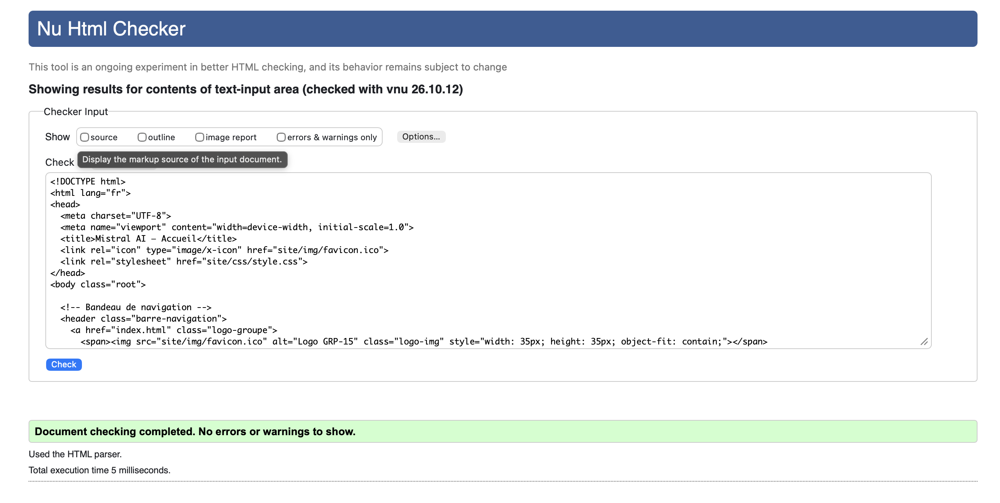

### Page histoire

**Auteur** MARTIN Clovis

Vérification W3C : [Détail ICI](https://validator.w3.org/nu/#textarea)

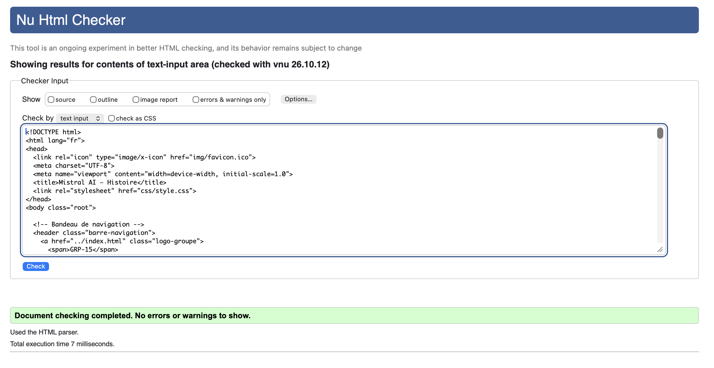

### Page services

**Auteur** RBAIHI Inas

Vérification W3C : [Détail ICI](https://validator.w3.org/nu/#textarea)

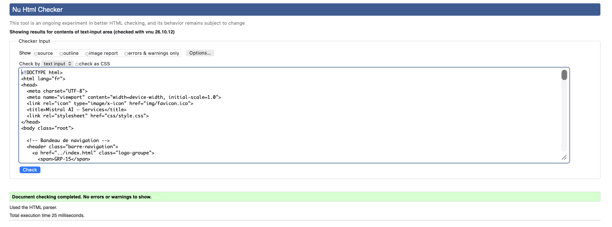

### Page economie

**Auteur** OZDEMIR Dogan

Vérification W3C : [Détail ICI](https://validator.w3.org/nu/#textarea)

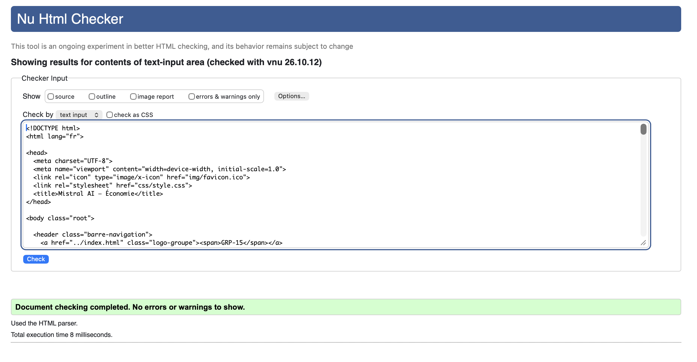

### Page écologie

**Auteur** POICHET Charles

Vérification W3C : [Détail ICI](https://validator.w3.org/nu/#textarea)

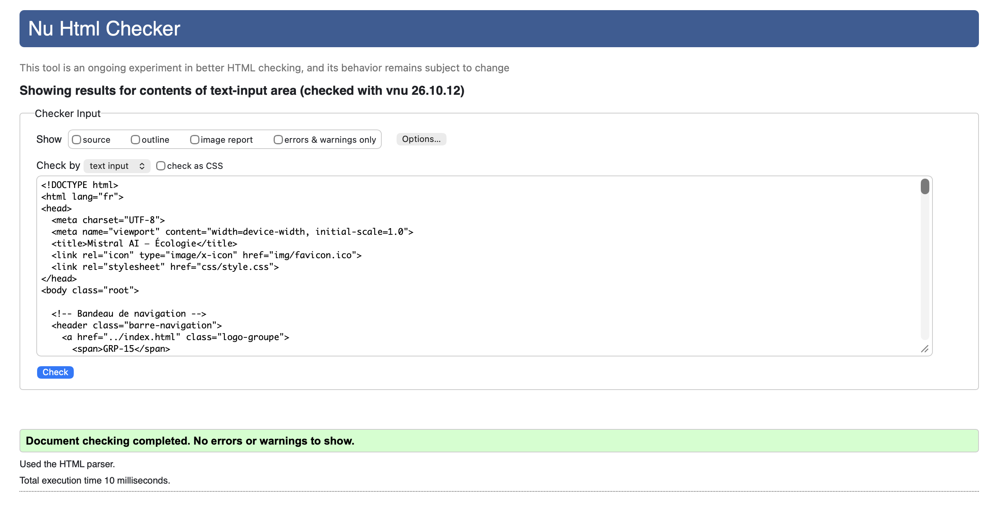

### Verification EcoIndex

**EcoIndex Accueil** [Détail ICI](https://www.ecoindex.fr/resultat/?id=a98ec8c9-5913-4cb8-a7c9-6a2cda8bd070)

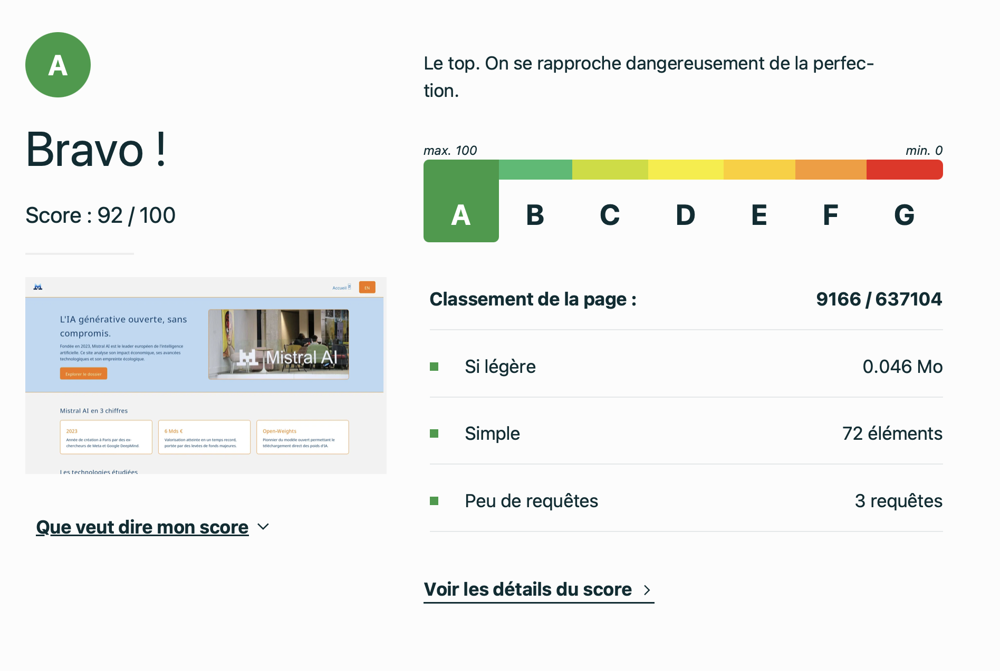

**EcoIndex Histoire** [Détail ICI](https://www.ecoindex.fr/resultat/?id=f0a5a6bd-c3b0-47d0-a1b8-0c8f3c80b367)

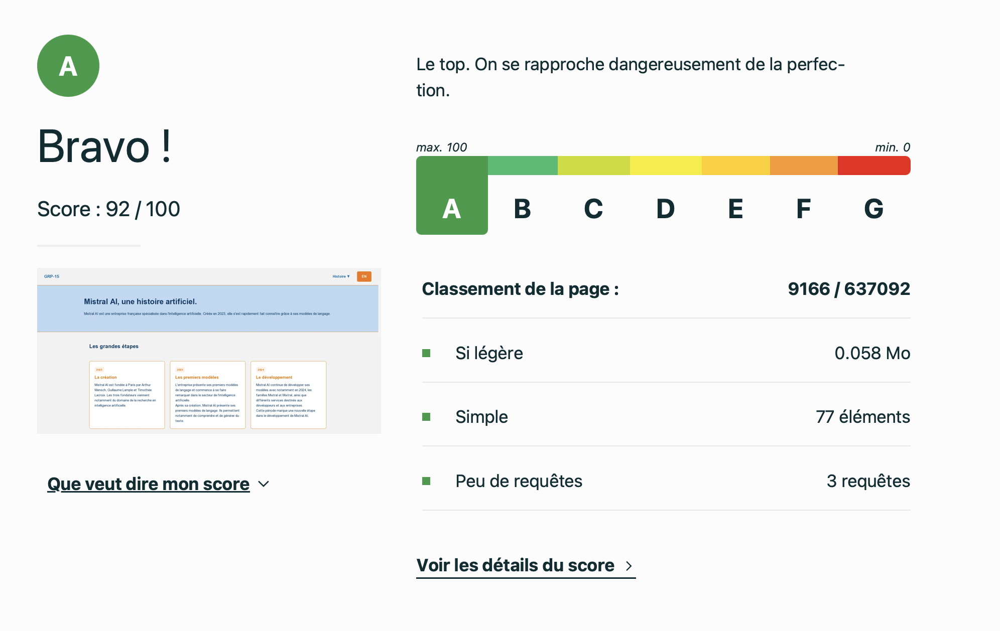

**EcoIndex Services** [Détail ICI](https://www.ecoindex.fr/resultat/?id=534de90b-8fd0-4d21-b40d-245856259769)

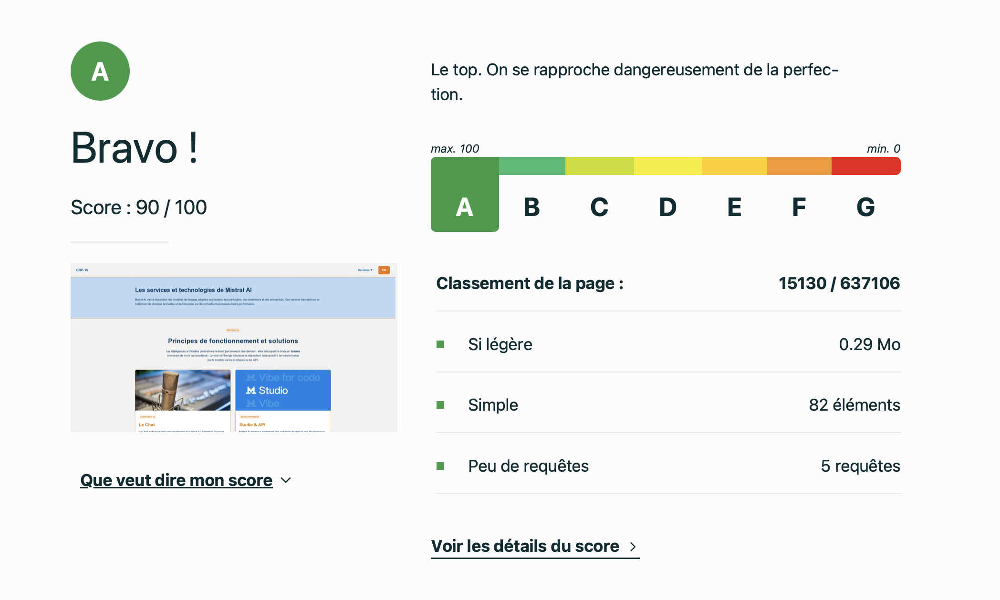

**EcoIndex Economie** [Détail ICI](https://www.ecoindex.fr/resultat/?id=e32b5161-3af1-4f90-b79d-92238aa3ae3f)

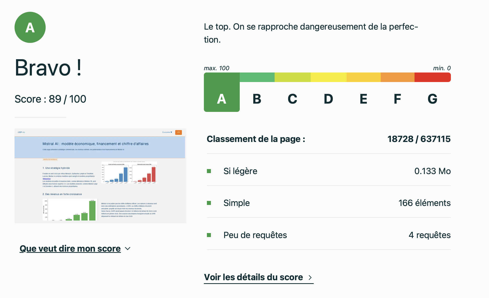

**EcoIndex Ecologie** [Détail ICI](https://www.ecoindex.fr/resultat/?id=621ee060-8bc7-4585-9d54-cfbcd27d2462)

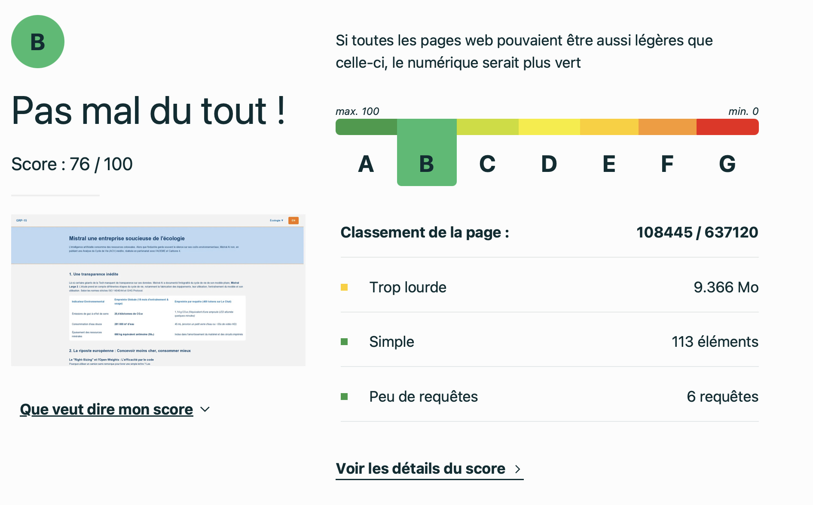

## Recherche d'information

- POICHET Charles, RBAIHI Inas, MARTIN Clovis, OZDEMIR Dogan -> recherche sur le contenu de la page d'accueil
- MARTIN Clovis -> recherche sur l'histoire de Mistral AI
- RBAIHI Inas -> recherche sur les services de l'entreprise Mistral AI
- OZDEMIR Dogan -> recherche sur les chiffres d'affaires et l'économie de Mistral AI
- POICHET Charles -> recherche sur l'aspect écologique de Mistral AI

## Développement du site et présentation des pages

# Accueil

**Auteur : Poichet Charles**  

Objectif : Capter l'attention du visiteur, poser l'identité visuelle de Mistral
AI et orienter vers les sections clés du site.

Contenu : Grand titre d'accroche valorisant l'IA générative accompagné
d'un visuel immersif ; résumé de la mission de l'entreprise en 2 ou 3
phrases ; cartes visuelles mettant en avant les points forts de la marque
(Open-source, Performance, Indépendance européenne) ; aperçu des
modèles phares.

# Histoire

**Auteur : Martin Clovis**  

Objectif : Présenter l'origine de Mistral AI, ses fondateurs et sa vision
stratégique.

Contenu : En-tête avec titre massif et visuel épuré ; récit de la création à
Paris par des chercheurs d'élite ; frise chronologique des étapes majeures ;
présentation des valeurs et de l'équipe.

# Services

**Auteur : Rbaihi Inas**  

Objectif : Détailler les offres technologiques, les modèles d'IA et leurs cas
d'usage concrets.

Contenu : Grille comparative de la gamme de modèles ; cas d'usage
métiers ; zone d'appel à l'action pour tester l'API ou contacter l'équipe.

# Economie

**Auteur : Ozdemir Dogan**  

Objectif : Expliquer le modèle économique de Mistral AI et son impact sur
le marché.

Contenu : Positionnement stratégique hybride (open-weight vs payant) ;
fonctionnement du modèle de tarification ; chiffres clés (levées de fonds,
valorisation) ; graphique comparatif du rapport coût/performance.

# Ecologie

**Auteur : Poichet Charles**

Objectif : Démontrer la démarche de responsabilité environnementale et
l'efficience énergétique des modèles.

Contenu : Engagements sur la sobriété numérique ; explications sur
l'optimisation des architectures IA ; tableau comparatif de l'empreinte
carbone et de la consommation d'énergie ; mise en avant des datacenters
décarbonés.

## Contributeurs

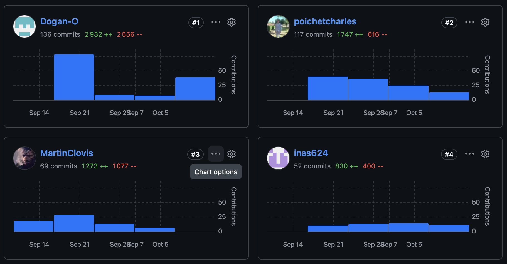
